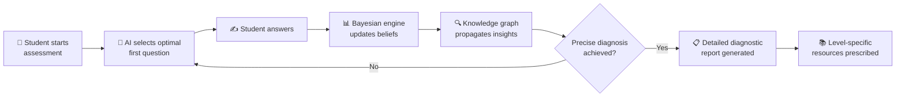
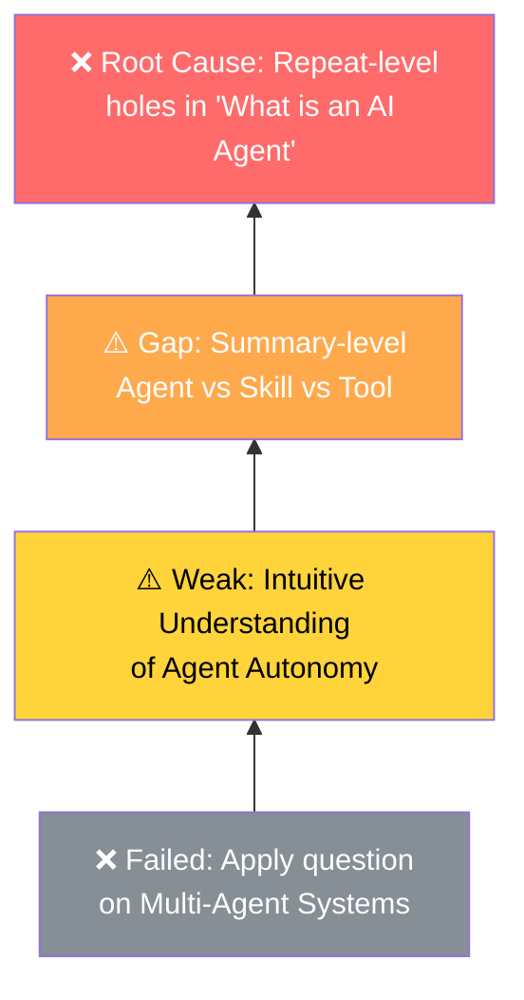
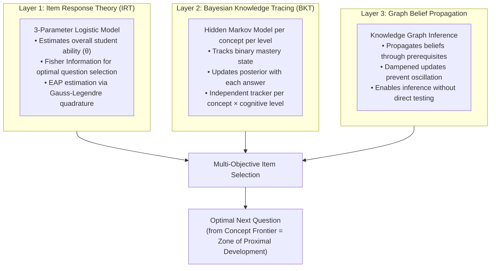
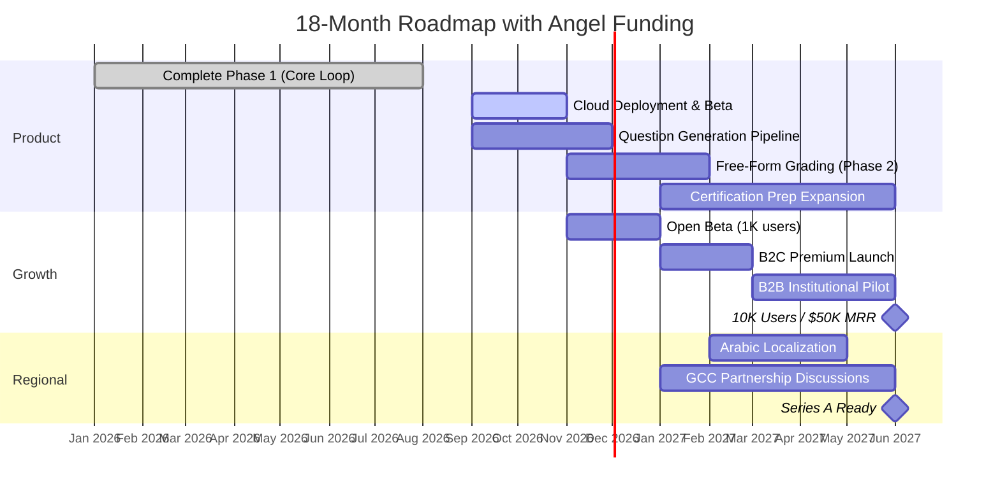

# IKAS — Investor Pitch Deck

### Intelligent Knowledge Assessment System
**Pre-Seed · Angel Round · August 2026**

---

## 1. The Problem

> **Students don't know what they don't know — and no tool today can tell them.**

### The $143B Test Prep Industry is Broken

Every year, **hundreds of millions** of learners preparing for competitive exams, professional certifications, and academic assessments face the same crippling problem:

| Pain Point | Impact | Scale |
|------------|--------|-------|
| **"What should I study?"** | Students waste **40–60% of study time** on already-mastered material | Universal |
| **"I studied everything but still failed"** | Illusion of competence from passive reading — students *think* they know, but don't | 30–40% of learners overestimate their ability (Dunning-Kruger) |
| **"Mock tests just give me a score"** | No root-cause diagnosis of *where* and *why* understanding breaks down | Every existing test prep platform |
| **"I know the theory but can't apply it"** | Gap between remembering facts and solving real-world problems | Critical for certifications & job readiness |

### The Science Behind the Problem

| Research Finding | Source | Implication |
|-----------------|--------|-------------|
| Students who re-read material predicted high exam scores but performed **50%+ lower** than retrieval-practice students | Karpicke & Blunt, *Science* (2011) | Passive study creates false confidence |
| Low-performing students overestimate their ability by **30–40%** | Dunning-Kruger research | Self-assessment is unreliable — an external diagnostic is essential |
| Retrieval practice yields **~80% recall** at one week vs. **~30%** for re-reading | Karpicke & Roediger, *Science* (2008) | Assessment-first approaches dramatically outperform traditional study |
| Immediate feedback increases retention by **20–30%** | Kulik & Kulik (1988) | Real-time gap identification accelerates learning |

> [!IMPORTANT]
> The core problem is **metacognitive** — the same knowledge required to answer correctly is required to evaluate whether you *can* answer correctly. This is why self-assessment fails and why an external, intelligent diagnostic is fundamentally necessary.

---

## 2. The Solution: IKAS

> **IKAS is an AI-powered adaptive assessment engine that diagnoses exactly what a learner doesn't know, at exactly which cognitive level, and prescribes a targeted learning path to close the gap.**

### How It Works — The "5-Minute Revelation"



### The Four Cognitive Levels (Based on Bloom's Taxonomy)

IKAS doesn't just test if you got the answer right — it tests **how deeply you understand**:

| Level | What It Tests | Example Question (AI Topic) |
|-------|---------------|----------------------------|
| **🔵 Repeat** | Can you recall the fact? | *"Which of the following are components of a transformer architecture?"* |
| **🟢 Summary** | Can you explain it in your own words? | *"Describe how attention mechanisms enable transformers to process long sequences."* |
| **🟡 Intuitive** | Do you truly understand it, or just memorize? | *"Three of these statements about attention are correct. One sounds right but has a subtle error. Select all correct statements."* |
| **🔴 Apply** | Can you use it to solve real problems? | *"A client's RAG system returns irrelevant results for domain-specific queries. Diagnose the likely causes and propose a solution."* |

### Root-Cause Diagnosis — Not Just a Score

**What competitors do:**
> "You scored 45% on AI Agents. Study more."

**What IKAS does:**



> **This is not just a score — it's a diagnosis with a treatment path.** IKAS traverses backward through the knowledge graph to locate the *exact prerequisite* where understanding breaks down.

---

## 3. Market Opportunity

### Global Market — A $6.5B+ Opportunity Growing 20%+ YoY

| Market Segment | 2025 Value | 2030 Projection | CAGR |
|----------------|-----------|-----------------|------|
| **Adaptive Learning** | $5.5–6.4B | $15–18B | 18–22% |
| **AI in Education** | $8.3–9.2B | $30B+ | 25–40% |
| **Test Preparation** | $142.8B | $200B+ | ~8% |
| **Global EdTech (Total)** | $187–404B | $500B+ | 13–17% |

### Middle East — Strategic Beachhead

> [!TIP]
> The Middle East, particularly the GCC region, represents one of the highest-growth EdTech markets globally, backed by sovereign wealth and national mandates.

| GCC Factor | Detail | Relevance to IKAS |
|------------|--------|-------------------|
| **Saudi Vision 2030** | National mandate to build a knowledge-based economy; AI curriculum mandatory for 6M+ students from 2025–2026 | Direct demand for AI-powered assessment tools |
| **Market Size** | ME EdTech market valued at **$12.3B (2025)** | Large, growing, well-funded |
| **Government PPPs** | Ministry of Education + SDAIA actively seeking private-sector AI education partners | B2G opportunity |
| **Education Spending** | Saudi education budget: **$53B+ annually** (largest budget line) | Deep pockets, clear priority |
| **Student Population** | 7.2M students projected by 2030 in Saudi alone | Massive scale potential |
| **UAE (Dubai/Abu Dhabi)** | Hub71, in5 accelerators; free zone company registration; 0% income tax | Founder-friendly incorporation |
| **Qatar** | Education City ecosystem; Qatar Foundation investments | Premium education market |

### Target Exam Markets for Expansion

| Priority | Market | Size / Opportunity | IKAS Fit |
|----------|--------|-------------------|----------|
| **Phase 1** | AI / Tech Skills & Certifications | $2.1B certification market, rapidly growing | First subject; validates the architecture |
| **Phase 2** | Tech Certifications (AWS, Azure, GCP, K8s) | 1.5M+ certifications/year | Scenario-based Apply questions; knowledge graphs map to service hierarchies |
| **Phase 3** | Indian Competitive Exams (JEE, NEET, UPSC, CAT, GATE) | **6M+ annual test-takers**, $2K–$10K spend per student | Desperate need for gap analysis; negative marking makes precision critical |
| **Phase 4** | Graduate Admissions (GRE, GMAT) | $1.2B test prep market | IKAS adds the diagnostic layer competitors lack |
| **Phase 5** | Professional (CFA, PMP, CPA) | Growing certification economy | 300+ hour study timelines make efficiency critical |

---

## 4. Technology — Deep, Defensible, and Built

### Adaptive Engine — Three-Layer Bayesian Architecture

IKAS combines three complementary mathematical models into a unified adaptive engine:



### Multi-Objective Question Selection

The next question is selected by maximizing a composite score across four pedagogical objectives:

$$\text{Score}(q) = \alpha \cdot I_q(\hat{\theta}) + \beta \cdot \text{GraphEntropy}(q) + \gamma \cdot \text{PrereqReadiness}(q) + \delta \cdot \text{LevelProgression}(q)$$

| Objective | Weight | Purpose |
|-----------|--------|---------|
| Fisher Information (α) | 0.35 | Maximum statistical information gain |
| Graph Entropy (β) | 0.25 | Resolve uncertainty across connected concepts |
| Prerequisite Readiness (γ) | 0.20 | Don't ask questions the student isn't ready for |
| Level Progression (δ) | 0.20 | Push upward through cognitive levels |

### Technology Stack

| Layer | Technology | Status |
|-------|-----------|--------|
| **Knowledge Graph** | Neo4j 5.x (ontology-ready, cross-subject) | ✅ Schema designed, seed data loaded |
| **Relational DB** | PostgreSQL 16 (users, sessions, responses) | ✅ Models & migrations built |
| **Backend API** | Flask 3.x + Python 3.12, Pydantic v2 DTOs | ✅ Core API built |
| **Frontend** | React 19 + TypeScript + Vite | ✅ Core UI built |
| **Adaptive Engine** | IRT + BKT + Graph Propagation (Python) | ✅ Engine implemented |
| **LLM Integration** | Provider abstraction (Gemini, OpenAI, Anthropic, Ollama) | ✅ Abstraction layer built |
| **Grading** | MCQ auto-grade + LLM rubric pipeline | ✅ Grading service built |
| **Deployment** | Docker Compose (dev) → Oracle Cloud OCI (prod) | 🔄 Docker ready, cloud planned |

### Intellectual Property & Defensibility

| Moat | Description |
|------|-------------|
| **Novel "Intuitive Understanding" Level** | No competitor explicitly tests for the gap between comprehension and true understanding — this is a genuine psychometric innovation |
| **Three-Layer Bayesian Engine** | Unique combination of IRT + BKT + Graph Belief Propagation with multi-objective scoring |
| **Ontology-Ready Knowledge Graph** | Designed from day one for OWL/RDF integration — enables future semantic reasoning across subjects |
| **Multi-Select Only Design** | All MCQs use checkboxes with partial-credit scoring — eliminates process-of-elimination guessing, a fundamental flaw in every competitor |
| **Cross-Subject Graph Architecture** | Single unified knowledge graph enables concepts shared across subjects (e.g., Statistics used in AI, Finance, and Data Science) |

---

## 5. Competitive Landscape

### No Platform Combines All Three of IKAS's Pillars

| Platform | Adaptive Algorithm | Knowledge Graph? | Bloom's Levels? | Subject Agnostic? | Root-Cause Diagnosis? |
|----------|-------------------|:-:|:-:|:-:|:-:|
| **ALEKS** (McGraw-Hill) | Knowledge Space Theory | Partial | ❌ | ❌ (K-12 math) | Topic-level only |
| **Knewton/Wiley Alta** | IRT + Predictive | Concept network | ❌ | ❌ (college) | Concept-level |
| **Embibe** | Custom ML + KG | ✅ (70K+ nodes) | ❌ | ❌ (JEE/NEET) | 3-vector |
| **Amboss** | Probabilistic + KG | ✅ (20K+ medical) | ❌ | ❌ (USMLE) | Concept-level |
| **Area9 Lyceum** | 4D Confidence×Competence | Network | ❌ | ❌ (enterprise) | Unconscious incompetence |
| **Khan Academy / Khanmigo** | LLM Socratic | Partial | Implicit | ❌ (SAT only) | Conversational |
| **Magoosh** | IRT simulation | ❌ | ❌ | ❌ (GRE/GMAT) | Topic % only |
| **IKAS** (Ours) | **IRT + BKT + Graph Propagation** | **✅ Ontology-ready** | **✅ 4 Levels** | **✅** | **✅ Prerequisite root-cause traversal** |

### IKAS's Unique Positioning

```
                    Knowledge Graph
                         │
                         │
            Embibe ●     │     ● IKAS ← Only platform here
            Amboss ●     │
                         │
    ─────────────────────┼──────────────────── Bloom's Taxonomy
                         │                     Cognitive Levels
           ALEKS ●       │
          Knewton ●      │
          Magoosh ●      │
                         │
                   No Graph
```

---

## 6. Business Model

### Revenue Strategy — Multi-Layered

| Revenue Stream | Model | Target Customer | Timing |
|---------------|-------|-----------------|--------|
| **B2C Freemium** | Free: 2 assessments/month, basic report. Premium: unlimited assessments, full diagnostic, resource recommendations | Individual learners, exam preppers | Phase 1 |
| **B2B / B2I (Institutional)** | Per-seat licensing for universities, coaching centers, corporate training | Universities, coaching institutes, enterprises | Phase 2 |
| **B2G (Government)** | Platform licensing for national assessment programs | Ministries of Education (Saudi, UAE, Qatar) | Phase 3 |
| **Content Partnerships** | Revenue share with content providers whose resources are recommended based on gap diagnosis | Coursera, Udemy, YouTube creators | Phase 2+ |
| **API / White-Label** | Assessment engine as a service for third-party platforms | LMS providers, corporate learning platforms | Phase 3+ |

### Pricing Framework (Indicative)

| Plan | Price Point | Comparable |
|------|-------------|------------|
| **Free** | $0 | 2 assessments/month, basic score report |
| **Learner Pro** | $9.99–14.99/month | Full diagnostics, unlimited assessments, resource maps |
| **Institutional** | $5–15/student/year | Cohort dashboards, instructor analytics, custom content |
| **Enterprise** | Custom | White-label, API access, dedicated support |

### Unit Economics Target (at Scale)

| Metric | Target |
|--------|--------|
| **CAC (B2C)** | < $5 (organic + content marketing) |
| **LTV (B2C Pro)** | $100–180 (10–12 month average subscription during exam prep cycle) |
| **LTV:CAC Ratio** | > 20:1 |
| **Gross Margin** | 80%+ (SaaS + LLM API costs) |

---

## 7. Go-To-Market Strategy

### Phase 1: Prove the Engine (Months 1–6)

- Launch with **AI/Tech Skills** as the first subject domain
- Build question bank: 500+ questions across 4 cognitive levels with prerequisite mapping
- Open beta with **tech communities** (dev.to, Reddit, Discord, X/Twitter)
- Target: **1,000 active users**, validate the "5-minute revelation" experience
- Collect response data to calibrate IRT parameters

### Phase 2: Expand & Monetize (Months 7–12)

- Add **AWS, Azure, GCP certification** prep (high willingness to pay)
- Launch B2C premium tier
- Partnership with **2–3 coaching institutes** in India or Middle East for B2B pilot
- Target: **10,000 users**, **$50K MRR**

### Phase 3: Scale Regionally (Months 13–24)

- Enter **Indian competitive exam market** (JEE, NEET, CAT)
- Arabic language support for GCC market penetration
- B2G pilot with a Gulf state Ministry of Education
- Target: **100,000 users**, **$500K MRR**

### Middle East Market Entry Strategy

| Approach | Detail |
|----------|--------|
| **Company Registration** | Flexible — willing to incorporate in UAE (DIFC/ADGM free zone), Saudi (SAGIA), or Qatar (QFC) based on investor preference |
| **Localization** | Arabic language support, RTL interface, regional exam content |
| **Government Alignment** | Position as Vision 2030 / HCDP-aligned assessment technology |
| **Strategic Partnerships** | Target connections with ETEC (Saudi), KHDA (Dubai), MOE partnerships |
| **Accelerator Track** | Apply to Hub71 (Abu Dhabi), in5 (Dubai), or Flat6Labs for ecosystem access |

---

## 8. Development Status

### What's Built ✅

| Component | Status | Detail |
|-----------|--------|--------|
| **Adaptive Engine** | ✅ Implemented | IRT (3PL) + BKT + Graph Belief Propagation + Multi-Objective Selection |
| **Knowledge Graph Schema** | ✅ Designed & Seeded | Neo4j with 4 AI topics, concept hierarchy, prerequisite edges, 60K+ lines of seed data |
| **Backend API** | ✅ Core Built | Flask REST API with auth, session management, grading, reporting services |
| **Frontend** | ✅ Core Built | React 19 + TypeScript — Login, Dashboard, Test, Results, Progress pages |
| **LLM Abstraction** | ✅ Built | Provider-agnostic layer supporting Gemini, OpenAI, Anthropic, Ollama |
| **Grading Service** | ✅ Built | MCQ auto-grade with partial credit + LLM rubric grading pipeline |
| **Docker Infrastructure** | ✅ Ready | Docker Compose for full local development stack |
| **Market Analysis** | ✅ Complete | Comprehensive competitive landscape and positioning analysis |

### What's Next 🔄

| Milestone | Description | Timeline |
|-----------|-------------|----------|
| **Question Bank (500+)** | Agentic generation pipeline + expert review for AI/Tech domain | 2–3 months |
| **Free-Form Grading** | LLM-based evaluation of Summary & Apply answers | 3–4 months |
| **Cloud Deployment** | OCI Free Tier → production deployment with CI/CD | 1–2 months |
| **Beta Launch** | Open beta with tech community, collect calibration data | 3 months |
| **Certification Prep** | AWS/Azure/GCP question banks and topic graphs | 4–6 months |

---

## 9. The Ask

### Pre-Seed Angel Round: $150K – $300K

| Use of Funds | Allocation | Purpose |
|-------------|------------|---------|
| **Product Development** | 40% | Full-time engineering to complete Phase 1, deploy cloud infrastructure, build question generation pipeline |
| **Content & Question Bank** | 25% | Subject matter experts + AI-assisted question authoring for 2,000+ calibrated questions |
| **Cloud & Infrastructure** | 10% | Production hosting, LLM API costs, monitoring, security |
| **Market Entry & GTM** | 15% | Beta launch, community building, initial partnerships, conference presence |
| **Legal & Incorporation** | 10% | Company registration (investor-preferred jurisdiction), IP protection, regulatory compliance |

### What the Investor Gets

| Term | Detail |
|------|--------|
| **Equity** | Negotiable — standard angel round terms (SAFE note or priced equity) |
| **Jurisdiction** | Flexible — willing to incorporate in UAE, Saudi Arabia, Qatar, or US based on investor preference |
| **Board Seat** | Available for lead investor |
| **Strategic Value** | Beyond capital: investor network in GCC education ecosystem, government introductions, regional market expertise |

### Key Milestones This Capital Unlocks



---

## 10. Why Now?

| Trend | Timing |
|-------|--------|
| **AI in Education inflection** | AI assessment tools market growing 25–40% CAGR — we're at the beginning of the adoption curve |
| **LLM cost collapse** | LLM API costs dropped 90%+ in 18 months — makes AI-powered grading economically viable at scale |
| **Vision 2030 acceleration** | Saudi Arabia mandated AI curriculum for 6M+ students; UAE investing heavily in EdTech infrastructure |
| **Post-COVID digital acceptance** | Institutions and learners are permanently comfortable with digital assessment |
| **Certification economy booming** | Professional certifications growing as the new credential — $2.1B market and expanding |
| **No incumbent has solved this** | Despite $6.5B+ in adaptive learning spend, no platform combines knowledge graphs + cognitive levels + Bayesian adaptation |

---

## 11. Vision

> **IKAS aims to become the world's most intelligent assessment engine — one that doesn't just test knowledge, but truly understands it.**

### The Long-Term Play

1. **Phase 1**: Prove the adaptive engine works with AI/Tech content → establish the scientific credibility
2. **Phase 2**: Expand to high-value certification markets (AWS, Azure, PMP, CFA) → generate revenue
3. **Phase 3**: Enter mass-market exam prep (JEE, NEET, GRE, GMAT) → achieve scale
4. **Phase 4**: Become the **assessment infrastructure layer** — API/white-label for any learning platform that needs intelligent diagnostics
5. **Phase 5**: Build the **world's largest cross-subject knowledge ontology** — a structured, machine-readable map of human knowledge that enables true adaptive learning across any domain

> [!IMPORTANT]
> The knowledge graph is the ultimate moat. Every student who takes a test contributes data that makes the graph smarter — calibrating probabilities, discovering new prerequisite relationships, and improving the adaptive engine. This creates a **compounding data flywheel** that becomes increasingly difficult to replicate over time.

---

## 12. Team & Contact

| Role | Status |
|------|--------|
| **Founder** | Technical founder — designed the adaptive engine architecture, built the full-stack prototype, authored the Bayesian inference model |
| **Advisors Needed** | EdTech domain expert, GCC market advisor, psychometrics specialist |
| **Key Hires (Post-Funding)** | ML Engineer (adaptive engine optimization), Content Lead (question bank), Growth Lead (GTM) |

### Looking For in an Angel Investor

- **Capital**: $150K–$300K pre-seed
- **Network**: Connections to GCC education ministries, coaching institutes, university leadership
- **Expertise**: EdTech market navigation, regulatory guidance in target jurisdictions
- **Patience**: This is a deep-tech product with a compounding data moat — value accelerates over time

---

> *"The most effective way to learn is to be tested on what you think you know — and to be surprised by what you don't."*
>
> **IKAS makes that surprise the starting point, not the endpoint.**

---

*Confidential · August 2026 · IKAS Pre-Seed Investment Memorandum*
