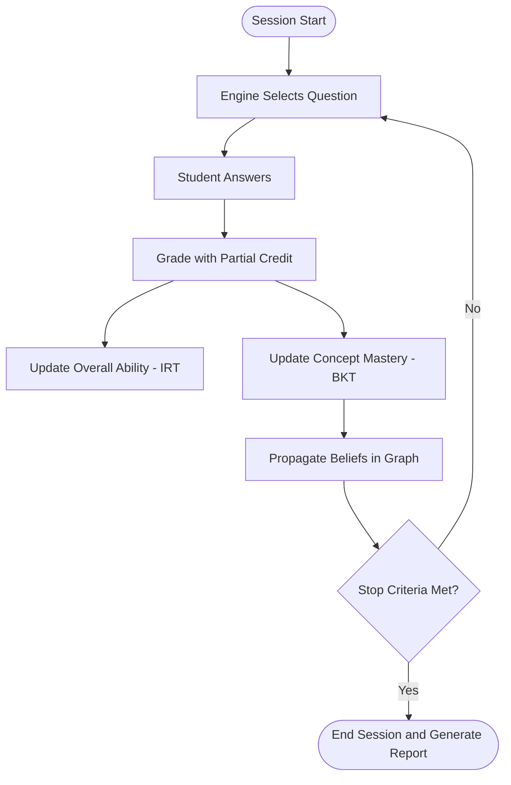
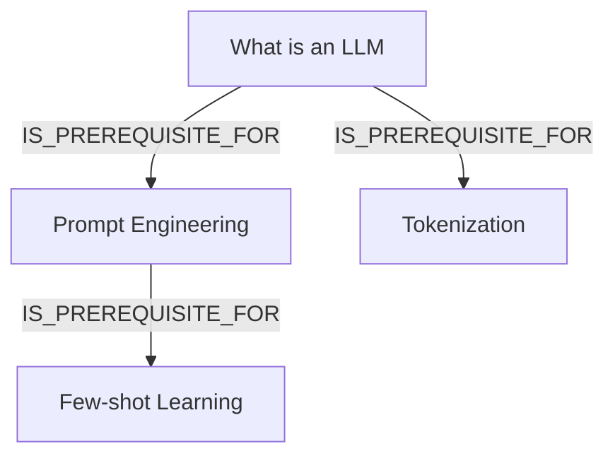

# The IKAS Adaptive Engine — How It Works

> [!NOTE]
> This guide is designed to help you understand the mathematical engine that powers IKAS. We will break down complex Bayesian statistics and psychometrics into intuitive concepts, using real-world analogies and concrete examples.

## 1. The Big Picture

### The Problem with Static Tests
Imagine a traditional exam with 20 questions. If a student is a beginner, they might get overwhelmed by difficult questions and learn nothing. If they are an expert, they will breeze through the easy questions, wasting time without demonstrating the true extent of their knowledge. Static tests are inefficient—they give the same experience to everyone, regardless of their actual ability.

### The Solution: An Adaptive Tutor
The IKAS Adaptive Engine acts like an experienced, one-on-one human tutor. It doesn't just ask a fixed list of questions. Instead, it:
1. **Observes** the student's answer.
2. **Updates** its mental model of what the student knows.
3. **Selects** the next best question to ask—specifically choosing questions that will teach it the most about the student's remaining knowledge gaps.

To do this, IKAS uses a combination of advanced mathematical models:
- **Item Response Theory (IRT)** to estimate overall ability.
- **Bayesian Knowledge Tracing (BKT)** to track mastery of specific concepts.
- **Graph Belief Propagation** to infer knowledge across connected topics.
- **Multi-Objective Item Selection** to balance testing goals.



## 2. Item Response Theory (IRT) — 3 Parameter Logistic Model

When a student answers a question, we want to update our estimate of their overall ability, denoted by $\theta$ (theta). IRT is a framework that connects a student's ability to their probability of answering a specific question correctly.

IKAS uses the **3-Parameter Logistic (3PL) Model**:

$$P_j(\theta) = c_j + \frac{1 - c_j}{1 + \exp\left(-a_j (\theta - b_j)\right)}$$

### The Parameters in Plain English:
- **$\theta$ (Student Ability):** Usually ranges from -3.0 (beginner) to +3.0 (expert). Average is 0.0.
- **$b_j$ (Item Difficulty):** The ability level required to have a 50% chance of getting the question right (ignoring guessing). Ranges from -3.0 to +3.0.
- **$a_j$ (Item Discrimination):** How well the question separates experts from beginners. A high $a$ means the probability jumps sharply around the difficulty level. Ranges from 0.1 to 3.0.
- **$c_j$ (Pseudo-Guessing):** The probability that a total beginner guesses correctly. For a 4-option multiple-choice question, this is typically 0.25.

### Worked Example
Imagine a student with an estimated ability of $\theta = 1.0$. They attempt a question with $a = 1.5$, $b = 0.5$, and $c = 0.25$.

1. The exponent is $-1.5 \times (1.0 - 0.5) = -0.75$.
2. $\exp(-0.75) \approx 0.472$.
3. The logistic part is $\frac{1 - 0.25}{1 + 0.472} = \frac{0.75}{1.472} \approx 0.509$.
4. Total probability $P(\theta) = 0.25 + 0.509 = 0.759$.

> [!TIP]
> The student has a **~76% chance** of answering this question correctly.

### Fisher Information
We want to ask questions that give us the most information about the student. Fisher Information $I(\theta)$ measures this:

$$I(\theta) = a^2 \cdot \frac{1 - P(\theta)}{P(\theta)} \cdot \left[\frac{P(\theta) - c}{1 - c}\right]^2$$

Maximum information is obtained when a question's difficulty matches the student's ability. Asking a calculus question to a toddler gives zero information, as does asking basic addition to a math professor.

## 3. Estimating Student Ability (EAP with Gauss-Legendre Quadrature)

We cannot simply calculate the percentage of correct answers. A student who gets 50% on incredibly hard questions is much more capable than a student who gets 50% on trivial questions.

Instead, we use a Bayesian approach called **Expected A Posteriori (EAP)** to estimate $\theta$.

1. **Prior Belief:** Before the test, we assume the student is average ($\theta = 0.0$ with a standard deviation of 1.0).
2. **Evidence (Likelihood):** The student answers questions. If they get a hard question right, the likelihood of them being highly skilled goes up.
3. **Posterior Belief:** We multiply the Prior by the Likelihood to get our new, updated belief.

### The Role of Gauss-Legendre Quadrature
To find the Expected value of the posterior, we need to calculate an integral. Since computers can't do continuous calculus perfectly, we use **Gauss-Legendre Quadrature**. It essentially picks 30 strategic points along the ability scale (e.g., -4.0, -3.8, ... +4.0) and calculates the probability at those specific points, then takes a weighted average.

````carousel
```text
State 1: Before Test
Prior: Normal distribution centered at θ = 0.0
We have no evidence yet. The engine assumes the student is average.
```
<!-- slide -->
```text
State 2: After 1 Correct Answer (Hard Question)
Evidence: Student answered a question with difficulty b=1.0 correctly.
Posterior: The distribution shifts to the right. New estimate: θ = 0.8.
```
<!-- slide -->
```text
State 3: After 1 Incorrect Answer (Moderate Question)
Evidence: Student missed a question with difficulty b=0.5.
Posterior: The distribution narrows and shifts slightly left. New estimate: θ = 0.6.
Confidence (Precision) increases as the curve gets narrower!
```
````

## 4. Bayesian Knowledge Tracing (BKT)

Overall ability ($\theta$) is great, but we also need to know exactly which concepts the student has mastered. That's where **Bayesian Knowledge Tracing (BKT)** comes in. It tracks the probability that a student has mastered a specific concept at a specific cognitive level (Repeat, Summary, Intuitive, Apply).

### The 4 BKT Parameters
- **$P(L_0)$ (Prior Knowledge):** The initial probability of mastery (default: 0.5).
- **$P(T)$ (Transition):** The chance a student learns the concept *during* the test (default: 0.1).
- **$P(G)$ (Guessing):** The chance of getting it right despite *not* knowing it (default: 0.2).
- **$P(S)$ (Slipping):** The chance of making a careless mistake despite *knowing* it (default: 0.1).

### The Update Formulas

If the student answers **correctly**:
$$P(L_t \mid \text{correct}) = \frac{P(L_t) \cdot (1 - P(S))}{P(L_t) \cdot (1 - P(S)) + (1 - P(L_t)) \cdot P(G)}$$

If the student answers **incorrectly**:
$$P(L_t \mid \text{incorrect}) = \frac{P(L_t) \cdot P(S)}{P(L_t) \cdot P(S) + (1 - P(L_t)) \cdot (1 - P(G))}$$

### Worked Example: "Tokenization"
1. **Start:** $P(L_0) = 0.5$ (50% chance of mastery).
2. **Q1 (Correct):** Plug into the correct formula: $\frac{0.5 \times 0.9}{(0.5 \times 0.9) + (0.5 \times 0.2)} = \frac{0.45}{0.45 + 0.1} = \frac{0.45}{0.55} \approx 0.818$.
3. **Transition Step:** Add the chance they learned it: $0.818 + (1 - 0.818) \times 0.1 = 0.836$.
4. **Result:** We are now 83.6% confident they have mastered "Tokenization".

Because we track this per cognitive level, mastering "Repeat" allows the engine to progress to testing "Summary".

## 5. Graph Belief Propagation

Concepts in IKAS are not isolated; they form a **Knowledge Graph**. "What is an LLM" is a prerequisite for "Prompt Engineering".

When a student demonstrates mastery of "Prompt Engineering", we can mathematically infer that they probably understand "What is an LLM", even if we haven't asked them about it directly.



### The Propagation Formula
For a connected concept $Q_B$ dependent on $Q_A$:
$$P(Q_B = 1) = P(Q_B = 1 \mid Q_A = 1) \cdot P(Q_A = 1) + P(Q_B = 1 \mid Q_A = 0) \cdot (1 - P(Q_A = 1))$$

To prevent the engine from jumping to wild conclusions and oscillating wildly, we apply a **50% Dampening factor**:
$$\text{New Belief}_{Q_B} = 0.5 \times \text{Old Belief}_{Q_B} + 0.5 \times \text{Propagated Belief}_{Q_B}$$

## 6. Multi-Objective Item Selection

If we only used IRT Fisher Information, the engine would jump randomly around the curriculum just to find questions that match the student's overall $\theta$. This is confusing for the learner.

IKAS selects the next question by maximizing a composite score across four objectives:

$$\text{Score}(q) = \alpha I_q(\hat{\theta}) + \beta \text{GraphEntropy}(q) + \gamma \text{PrereqReadiness}(q) + \delta \text{LevelProgression}(q)$$

| Objective | Weight | What it does |
|-----------|--------|--------------|
| **Fisher Info ($\alpha$)** | 0.35 | Asks questions that differentiate the student's ability well. |
| **Graph Entropy ($\beta$)** | 0.25 | Favors questions that act as hubs in the graph, resolving uncertainty for many connected concepts at once. |
| **Prereq Readiness ($\gamma$)**| 0.20 | Prevents asking advanced questions if foundational prerequisites are not mastered yet. |
| **Level Progression ($\delta$)**| 0.20 | Gently pushes the student up the cognitive ladder (Repeat → Summary → Intuitive → Apply). |

### The Concept Frontier
The engine only considers candidate questions that sit on the **Concept Frontier**—the "Zone of Proximal Development". These are concepts where the prerequisites *are* mastered ($P \ge 0.7$), but the concept itself is *not yet* mastered.

## 7. Partial Credit Grading

IKAS intentionally avoids radio buttons. All multiple-choice questions use checkboxes. This allows for nuanced **Partial Credit**.

If a student selects 2 out of 3 correct options, they should not get a 0. But if they just check every single box, they should not get full credit either.

**The Formula:**
$$\text{Score} = \left(\frac{\text{Correct Selected}}{\text{Total Correct}}\right) - \left(\text{Incorrect Selected} \times 0.5\right)$$
$$\text{Final Score} = \max(0.0, \text{Score})$$

### Examples
- **Perfect:** 2 correct options, student checks both. Score = (2/2) - (0) = **1.0**
- **Partial:** 3 correct options, student checks 2. Score = (2/3) - (0) = **0.67**
- **Over-selection (Guessing):** 2 correct options, student checks both, PLUS 1 incorrect option. Score = (2/2) - (1 × 0.5) = 1.0 - 0.5 = **0.50**

## 8. Putting It All Together — A Complete Test Session

Let's watch the engine in action across a 5-question test.

| Step | Action / State Change | Why it happened |
|------|-----------------------|-----------------|
| **1** | **Ask:** *What is an LLM? (Repeat)* | Engine starts at the foundation. |
| | **Student:** Correct (1.0) | |
| | **State:** $\theta$ rises to 0.4. Mastery of LLM(Repeat) jumps to 84%. | Prior was 0.0, evidence shifted it up. |
| **2** | **Ask:** *What is an LLM? (Summary)* | Level Progression bonus pushed the engine to test higher cognition on the mastered concept. |
| | **Student:** Partial Credit (0.6) | |
| | **State:** $\theta$ stays ~0.4. Mastery of LLM(Summary) rises slightly to 60%. | |
| **3** | **Ask:** *Prompt Engineering (Repeat)* | Concept Frontier expanded because the LLM prerequisite was mastered. |
| | **Student:** Incorrect (0.0) | |
| | **State:** $\theta$ drops to 0.1. Mastery drops to 21%. | |
| **4** | **Ask:** *Tokenization (Repeat)* | Prompt Engineering failed, so engine pivots to a different branch of the graph. |
| | **Student:** Correct (1.0) | |
| | **State:** $\theta$ rises to 0.5. Mastery jumps to 84%. | |

> [!CAUTION]
> Notice how the engine does not just hammer the student with more "Prompt Engineering" questions after they fail. It recognizes the gap and pivots horizontally to a parallel concept ("Tokenization"). This mirrors how a skilled tutor would behave.

## 9. Stopping Criteria

The test does not go on forever. It stops when ANY of these conditions are met:
1. **Time Limit Expired:** e.g., 15 minutes for a Quick Check.
2. **Question Limit Reached:** e.g., 10 questions total.
3. **Precision Reached:** If the Standard Error (SE) of the $\theta$ estimate drops below **0.3** (after at least 5 questions), the engine is highly confident in its assessment and stops early to save the student time.

## 10. Key Design Decisions

Why did we build it this way?

- **Why EAP over MLE?** Maximum Likelihood Estimation (MLE) breaks down if a student gets all questions right or all wrong early in the test (it shoots off to infinity). EAP uses a prior distribution, keeping the estimate stable and bounded.
- **Why 50% Dampening?** In dense graphs, one correct answer could chain-react and artificially inflate mastery across 10 connected concepts. Dampening ensures the engine remains skeptical and requires direct evidence eventually.
- **Why multi-objective weights (0.35/0.25/0.20/0.20)?** Commercial Computerized Adaptive Testing (CAT) systems often *only* use Fisher Information. This creates disjointed, confusing tests that jump between unrelated topics. Our 4-part formula ensures a pedagogical, smooth flow that respects cognitive level progression and prerequisite structure.
- **Why checkboxes, not radio buttons?** Multi-select MCQs with partial credit scoring provide a much richer signal about student understanding. A student who selects 2 out of 3 correct answers demonstrates more knowledge than one who selects 0, and the adaptive engine needs this granularity.
