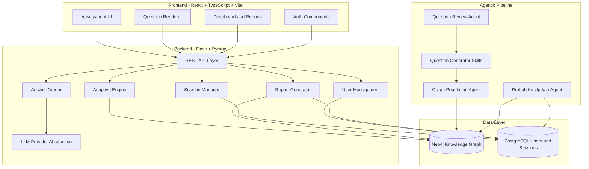
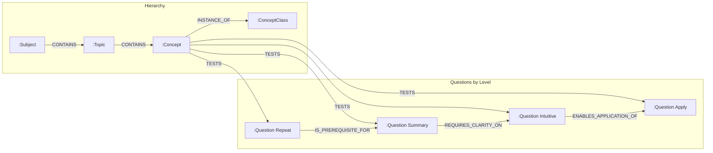
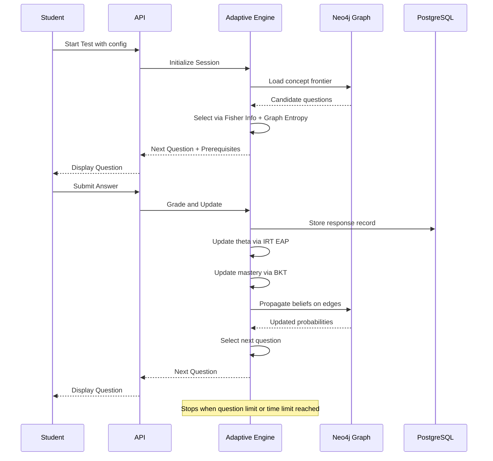

# IKAS — Intelligent Knowledge Assessment System

## Overview

IKAS is an adaptive assessment platform that evaluates a learner's knowledge across four cognitive levels — **Repeat**, **Summary**, **Intuitive Understanding**, and **Apply** — using a Neo4j-backed knowledge graph, Bayesian inference engine, and modern web frontend. The system identifies knowledge gaps, selects optimal next questions, and guides learners toward achieving **Apply**-level mastery.

---

## Resolved Decisions (from User Feedback)

> [!NOTE]
> All open questions from the initial plan have been resolved. Decisions are captured in [project.md](file:///Users/dantepilla/Documents/Antigravity/IKAS/project.md) as architectural decisions (AD-001 through AD-006).

| Decision | Resolution |
|----------|-----------|
| **Repository** | Monorepo — `backend/`, `frontend/`, `knowledge-graph/` in one repo |
| **Jira** | New project to be created at [Atlassian](https://home.atlassian.com/o/13965868-fbd6-41c0-8189-1730ef64c427/?cloudId=e3eb6984-92f7-4415-a8f6-475be69f24a6). Confluence page for documentation. |
| **Tech Stack** | Confirmed as proposed. Added **LLM provider abstraction** for model switching. |
| **Knowledge Graph** | **Single graph** for all subjects, partitioned by `(:Subject)` node hierarchy. Ontology-ready design using neosemantics (n10s). |
| **First Subject** | AI — Topics: LLMs & Prompting, AI Agents & Orchestration, AI Tools & Frameworks, RAG |
| **User Roles** | Student, Instructor/Admin, Question Author. Organization → Cohort → Student grouping. |
| **Test Config** | Both duration and question count configurable. Pre-defined presets: Quick Check (10q/15min), Standard (25q/45min), Comprehensive (50q/90min), Custom. |
| **Deployment** | Oracle Cloud (OCI) Always Free Tier — 2 ARM VMs (4 OCPU, 24GB RAM each). No AWS. Docker Compose for local dev. |
| **Response Storage** | Every student response stored in PostgreSQL for aggregated probability recalibration. |
| **Ontologies** | Schema designed ontology-ready from Day 1. `(:ConceptClass)` meta-layer and typed relationships for future OWL/RDF import via n10s. |

---

## Architecture

### High-Level System Architecture



### Data Model — Knowledge Graph (Neo4j)



#### Node Properties

| Node Label | Key Properties |
|------------|---------------|
| **Subject** | `id`, `name`, `description` |
| **Topic** | `id`, `name`, `description`, `subject_id` |
| **Concept** | `id`, `name`, `description`, `topic_id` |
| **ConceptClass** | `id`, `uri`, `label` (e.g., "Technique", "Tool", "Theory", "Framework") — ontology meta-layer |
| **Question** | `id`, `stem` (question text), `level` (Repeat/Summary/Intuitive/Apply), `question_type` (mcq_multi/free_text/image_upload/code_link/image_question), `options` (list for MCQ), `correct_answers` (list), `explanation`, `difficulty` (IRT b), `discrimination` (IRT a), `guessing` (IRT c), `concepts_tested` (list), `resources` (map by level), `rubric` (for free-form), `time_estimate_seconds`, `created_at`, `updated_at`, `is_active` |
| **Resource** | `id`, `title`, `url`, `type` (video/blog/documentation/course), `knowledge_level`, `source`, `is_free` |

#### Edge Properties

| Edge Type | From to To | Properties |
|-----------|-----------|------------|
| `IS_PREREQUISITE_FOR` | Repeat to Summary, Repeat to Repeat | `weight`, `p_pass_given_pass`, `p_pass_given_fail`, `relationship_description` |
| `REQUIRES_CLARITY_ON` | Summary to Intuitive | `weight`, `p_pass_given_pass`, `p_pass_given_fail`, `relationship_description` |
| `ENABLES_APPLICATION_OF` | Intuitive/Summary to Apply | `weight`, `p_pass_given_pass`, `p_pass_given_fail`, `relationship_description` |
| `TESTS` | Concept to Question | `mastery_impact` |
| `LINKED_RESOURCE` | Question to Resource | `relevance_score` |
| `INSTANCE_OF` | Concept to ConceptClass | — (ontology classification) |

#### User/Session Data Model (PostgreSQL)

| Table | Purpose |
|-------|---------|
| `users` | id, username, email, password_hash, role, organization_id, created_at |
| `organizations` | id, name, created_at |
| `cohorts` | id, name, organization_id, created_at |
| `cohort_members` | cohort_id, user_id, joined_at |
| `test_sessions` | id, user_id, subject_id, topic_id, start_time, end_time, status, config (JSON) |
| `responses` | id, session_id, user_id, question_id, question_level, user_answer (JSONB), is_correct, partial_score, grading_details (JSONB), time_taken_seconds, created_at |
| `user_mastery` | user_id, concept_id, level, mastery_probability, last_updated |
| `test_results` | session_id, overall_score, level_breakdown (JSON), recommendations (JSON) |

> [!NOTE]
> **Why two databases?** Neo4j excels at graph traversal for prerequisite chains and probability propagation. PostgreSQL excels at relational data: user accounts, session history, response logs, and aggregate reporting. The `responses` table stores every individual answer for future probability recalibration.

---

### Adaptive Engine — Bayesian Inference Flow

The engine combines three complementary techniques:



#### Item Selection Algorithm (Multi-Objective)

The next question is selected by maximizing a composite score:

$$\text{Score}(q) = \alpha \cdot I_q(\hat{\theta}) + \beta \cdot \text{GraphEntropy}(q) + \gamma \cdot \text{PrereqReadiness}(q) + \delta \cdot \text{LevelProgression}(q)$$

Where:
- $I_q(\hat{\theta})$ = Fisher Information at current ability estimate (IRT)
- $\text{GraphEntropy}(q)$ = information gain from answering this question
- $\text{PrereqReadiness}(q)$ = proportion of prerequisite questions answered correctly
- $\text{LevelProgression}(q)$ = bonus for testing the next cognitive level up

---

## Proposed Changes — Phased Development

### Phase 1: Foundation and Core Adaptive Loop (MVP)

**Goal**: A working end-to-end system where a student can take an adaptive test on a single AI topic, with MCQ questions across all 4 knowledge levels, automated grading, Bayesian question selection, and a basic results report.

---

#### Backend Infrastructure

##### [NEW] [backend/](file:///Users/dantepilla/Documents/Antigravity/IKAS/backend/)
Flask application with the following structure:

```
backend/
├── app/
│   ├── __init__.py              # Flask app factory
│   ├── config.py                # Configuration (Neo4j URI, JWT secrets, LLM config)
│   ├── extensions.py            # Neo4j driver extension, JWT manager
│   ├── api/
│   │   ├── __init__.py
│   │   └── v1/
│   │       ├── __init__.py
│   │       ├── auth.py          # Login, register, token refresh
│   │       ├── tests.py         # Start test, submit answer, get next question
│   │       ├── questions.py     # CRUD for questions (admin)
│   │       └── reports.py       # Test results, progress reports
│   ├── services/
│   │   ├── __init__.py
│   │   ├── adaptive_engine.py   # IRT + BKT + Graph propagation
│   │   ├── grading_service.py   # MCQ auto-grading + LLM grading stub
│   │   ├── llm_provider.py      # Configurable LLM abstraction (Gemini/OpenAI/Anthropic/Ollama)
│   │   ├── session_service.py   # Test session management
│   │   └── report_service.py    # Result aggregation
│   ├── repositories/
│   │   ├── __init__.py
│   │   ├── question_repo.py     # Neo4j Cypher queries for questions
│   │   ├── graph_repo.py        # Graph traversal, probability updates
│   │   └── user_repo.py         # PostgreSQL user operations
│   ├── models/
│   │   ├── __init__.py
│   │   ├── dtos.py              # Pydantic v2 request/response schemas
│   │   └── db_models.py         # SQLAlchemy models for PostgreSQL
│   └── utils/
│       ├── __init__.py
│       └── math_utils.py        # IRT formulas, Bayesian updates
├── tests/
│   ├── test_adaptive_engine.py
│   ├── test_grading.py
│   └── test_api.py
├── migrations/                  # Alembic migrations for PostgreSQL
├── pyproject.toml
├── requirements.txt
└── Dockerfile
```

**Key Implementation Details:**

1. **Adaptive Engine** (`adaptive_engine.py`):
   - 3-Parameter Logistic (3PL) IRT model for item difficulty/discrimination
   - Expected A Posteriori (EAP) theta estimation using Gauss-Legendre quadrature
   - Bayesian Knowledge Tracing (BKT) per concept per cognitive level
   - Graph belief propagation on prerequisite edges
   - Multi-objective item selection: Fisher Information + prerequisite readiness + level progression

2. **LLM Provider** (`llm_provider.py`):
   - Abstract base class with `generate()` and `generate_structured()` methods
   - Implementations: GeminiProvider (default), OpenAIProvider, AnthropicProvider, OllamaProvider
   - Configured via environment variables: `LLM_PROVIDER`, `LLM_MODEL`, `LLM_API_KEY`
   - Hot-switchable without code changes

3. **Neo4j Integration** (`extensions.py`):
   - Singleton `neo4j.Driver` with connection pooling (max 50 connections)
   - Per-request `Session` with managed transactions
   - Raw Cypher queries via Repository pattern (not OGM) for full Cypher expressiveness

4. **Grading Service** (`grading_service.py`):
   - Phase 1: Auto-grade MCQ (multi-select comparison with partial credit)
   - Stub for LLM-based free-form grading (Phase 2)
   - All responses stored in PostgreSQL `responses` table

5. **API Endpoints (Phase 1)**:

   | Method | Endpoint | Description |
   |--------|----------|-------------|
   | POST | `/api/v1/auth/register` | User registration |
   | POST | `/api/v1/auth/login` | Login, returns JWT |
   | POST | `/api/v1/auth/refresh` | Refresh access token |
   | GET | `/api/v1/tests/topics` | List available topics |
   | GET | `/api/v1/tests/presets` | Get pre-defined test configurations |
   | POST | `/api/v1/tests/start` | Start adaptive test session (with config) |
   | GET | `/api/v1/tests/{session_id}/next` | Get next question |
   | POST | `/api/v1/tests/{session_id}/answer` | Submit answer, get feedback |
   | POST | `/api/v1/tests/{session_id}/end` | End test, get results |
   | GET | `/api/v1/reports/{session_id}` | Detailed session report |
   | GET | `/api/v1/reports/progress` | User progress over time |

---

#### Frontend Application

##### [NEW] [frontend/](file:///Users/dantepilla/Documents/Antigravity/IKAS/frontend/)
React + TypeScript + Vite application:

```
frontend/
├── src/
│   ├── api/
│   │   ├── client.ts            # Axios instance + JWT interceptors
│   │   ├── auth.ts              # Auth API calls
│   │   ├── tests.ts             # Test session API calls
│   │   └── reports.ts           # Reports API calls
│   ├── components/
│   │   ├── layout/
│   │   │   ├── Header.tsx
│   │   │   ├── Sidebar.tsx
│   │   │   └── Layout.tsx
│   │   ├── auth/
│   │   │   ├── LoginForm.tsx
│   │   │   └── RegisterForm.tsx
│   │   ├── questions/
│   │   │   ├── QuestionCard.tsx       # Main question display
│   │   │   ├── MCQRenderer.tsx        # Multi-select MCQ (checkboxes only)
│   │   │   ├── FreeTextRenderer.tsx   # Text area (Phase 2)
│   │   │   ├── ImageQuestionRenderer.tsx
│   │   │   ├── PrerequisitePanel.tsx  # Shows prerequisite knowledge
│   │   │   ├── ResourcePanel.tsx      # Links to learning resources
│   │   │   └── Timer.tsx              # Question/test timer
│   │   ├── dashboard/
│   │   │   ├── TopicSelector.tsx
│   │   │   ├── TestConfig.tsx         # Configure test params + presets
│   │   │   └── ProgressCard.tsx
│   │   └── reports/
│   │       ├── ResultSummary.tsx
│   │       ├── LevelBreakdown.tsx     # Per-level mastery chart
│   │       ├── KnowledgeMap.tsx       # Graph visualization of mastery
│   │       └── ResourceRecommendations.tsx
│   ├── hooks/
│   │   ├── useAuth.ts
│   │   ├── useTest.ts
│   │   └── useTimer.ts
│   ├── store/
│   │   ├── authStore.ts         # Zustand auth state
│   │   └── testStore.ts         # Zustand test session state
│   ├── pages/
│   │   ├── LoginPage.tsx
│   │   ├── DashboardPage.tsx
│   │   ├── TestPage.tsx
│   │   ├── ResultsPage.tsx
│   │   └── ProgressPage.tsx
│   ├── styles/
│   │   ├── index.css            # Design system tokens and globals
│   │   ├── components.css       # Component styles
│   │   └── pages.css            # Page-level styles
│   ├── App.tsx
│   ├── main.tsx
│   └── router.tsx               # React Router v7
├── public/
├── package.json
├── tsconfig.json
└── vite.config.ts
```

**Key UI Features (Phase 1):**
- **Dashboard**: Topic selection, test configuration with preset selector (Quick Check / Standard / Comprehensive / Custom), prerequisite panel toggle
- **Test Page**: Question display with timer, prerequisite knowledge panel (collapsible, on by default), resource links panel, multi-select MCQ with checkbox-style answers (never radio buttons)
- **Results Page**: Overall score, per-level breakdown (Repeat/Summary/Intuitive/Apply), concept-by-concept mastery, recommended resources organized by knowledge level
- **Progress Page**: Historical test performance, trend lines per topic

---

#### Knowledge Graph Seed Data

##### [NEW] [knowledge-graph/](file:///Users/dantepilla/Documents/Antigravity/IKAS/knowledge-graph/)

```
knowledge-graph/
├── schema/
│   ├── constraints.cypher       # Neo4j constraints, indexes, ontology setup
│   └── seed_data.cypher         # Initial subject/topic/concept hierarchy
├── agents/
│   ├── question_generator/
│   │   ├── repeat_generator.py
│   │   ├── summary_generator.py
│   │   ├── intuitive_generator.py
│   │   ├── apply_generator.py
│   │   └── prompts/
│   │       ├── repeat_prompt.md
│   │       ├── summary_prompt.md
│   │       ├── intuitive_prompt.md
│   │       └── apply_prompt.md
│   ├── review_agent/
│   │   ├── reviewer.py
│   │   └── rubric.md
│   └── graph_populator/
│       └── populator.py
├── ontology/
│   ├── concept_classes.json     # ConceptClass definitions (Technique, Tool, etc.)
│   └── README.md                # Ontology design notes for future expansion
├── data/
│   ├── ai_topic_hierarchy.json
│   └── generated/
└── scripts/
    ├── generate_questions.py
    └── populate_graph.py
```

**Question Generation Strategy** (skills, not full agents):

| Generator | Question Style | Answer Format | Key Prompt Elements |
|-----------|---------------|---------------|---------------------|
| **Repeat** | Direct factual recall | Multi-select MCQ (straightforward options) | Generate fundamental definition/fact questions. Options clearly distinguishable. |
| **Summary** | Broad comprehension | Free-text or multi-select MCQ | Generate questions requiring synthesis of multiple concepts. Map prerequisite Repeat concepts. |
| **Intuitive** | Confusing/tricky options | Multi-select MCQ (deliberately confusing distractors) | Generate questions with plausible-but-wrong options. Subtle omissions and rephrasing. |
| **Apply** | Scenario-based problem | Free-text / code link / image upload | Generate real-world scenarios requiring applied problem solving. |

---

#### Infrastructure and DevOps

##### [NEW] [docker-compose.yml](file:///Users/dantepilla/Documents/Antigravity/IKAS/docker-compose.yml)
Docker Compose for local development:
- Neo4j 5.x container (ports 7474/7687)
- PostgreSQL 16 container (port 5432)
- Flask backend container (port 5000)
- React dev server (port 5173)

##### [NEW] [.env.example](file:///Users/dantepilla/Documents/Antigravity/IKAS/.env.example)
Environment variable template including LLM provider configuration.

---

### Phase 2: Free-Form Answers, LLM Grading and Enhanced UX

**Goal**: Support all answer types with LLM-based grading, richer reporting, and a polished assessment experience.

| Component | Changes |
|-----------|---------|
| **Grading Service** | 4-tier hybrid pipeline: Sanity filter, SBERT similarity, LLM rubric grading (configurable model), Confidence check. |
| **Question Types** | Free-text (Summary), image upload (Summary/Apply), code link (Apply), image-based questions (any level). |
| **Frontend** | Rich text editor, drawing canvas, file upload, code link input with preview. |
| **Prerequisite Panel** | Interactive — click prerequisite to see mini-explainer or resource link. |
| **Reports** | D3.js knowledge gap graph (nodes colored by mastery). Exportable PDF reports. |
| **Test Configuration** | Admin panel for test blueprints: min/max per level, time limits, panel visibility. |

---

### Phase 3: Advanced Adaptive Engine and Scaling

**Goal**: Production-grade adaptive testing with content balancing, exposure control, and probability recalibration.

| Component | Changes |
|-----------|---------|
| **Shadow Testing** | MILP-based content balancing (PuLP/OR-Tools) for blueprint constraints. |
| **Exposure Control** | Sympson-Hetter algorithm to prevent item over-exposure. |
| **Probability Recalibration Agent** | Scheduled agent: queries `responses` table, computes empirical conditional probabilities, updates Neo4j edges via Bayesian smoothing. Updates IRT parameters via EM algorithm. |
| **Multi-Subject Support** | Extend graph to new subjects. Cross-subject concept linking. |
| **User Roles** | Full role implementation: Student, Instructor, Admin, Question Author. Cohort management. |
| **Ontology Integration** | Import OWL/RDF ontologies via n10s. Map concepts to standard classifications (e.g., ACM CCS). |

---

### Phase 4: Agentic Orchestration and Continuous Improvement

**Goal**: Self-improving system with autonomous question generation, review, and test orchestration.

| Component | Changes |
|-----------|---------|
| **Assessment Session Agent** | Orchestrates full test sessions autonomously. |
| **Continuous Question Generation** | Triggered by gaps in student performance data. Specialist skills per level with review. |
| **Automated QA** | LLM-based Bloom level classifier. Psychometric analysis to flag low-discrimination items. |
| **Jira Integration** | Agent creates/manages user stories. Parallel development with sprint-based agent work. |

---

## Verification Plan

### Automated Tests

#### Backend
```bash
# Unit tests for adaptive engine (IRT, BKT, graph propagation)
cd backend && pytest tests/test_adaptive_engine.py -v

# API integration tests
cd backend && pytest tests/test_api.py -v

# Grading service tests
cd backend && pytest tests/test_grading.py -v
```

#### Frontend
```bash
# Component tests
cd frontend && npm run test

# E2E tests (Playwright)
cd frontend && npx playwright test
```

### Manual Verification
1. **Adaptive Loop Validation**: Run a test session, verify question escalation and prerequisite probing
2. **Graph Integrity**: Inspect Neo4j Browser for nodes, edges, and probability values
3. **Report Accuracy**: Compare generated report against manually traced session
4. **UI/UX Review**: Walk through all user flows on desktop and tablet viewports
5. **Response Storage**: Verify every answer is persisted in PostgreSQL `responses` table

---

## Summary

| Phase | Scope | Key Deliverables |
|-------|-------|-----------------|
| **Phase 1** (MVP) | Core adaptive loop with MCQ on AI topics | Working assessment with Bayesian selection, MCQ grading, prerequisite panels, resource links, basic reporting, configurable test presets |
| **Phase 2** | Full answer types + LLM grading | Free-text, image upload, code link; configurable LLM grading; knowledge gap visualization |
| **Phase 3** | Production scaling | Shadow testing, exposure control, probability recalibration agent, multi-subject, ontology import |
| **Phase 4** | Agentic orchestration | Session agent, continuous question generation, automated QA, Jira integration |

Ready to begin **Phase 1** upon approval. Will create task breakdown and spin up parallel agents for infrastructure, backend, frontend, and knowledge graph seeding.
